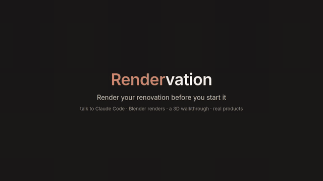

# Home Maker

Photoreal 3D models of rooms, before and after a remodel, with a walkthrough you can open in the
browser. One room at a time, in any house.

**Claude Code runs this project.** You talk; Claude does the modeling, rendering and
bookkeeping. Send it photos, measurements, product links and ideas, and it builds the room in
Blender, renders options side by side, and records every choice. You don't need to run any of
the scripts yourself.

*A real Claude Code session, sped up ([full video](docs/demo.mp4)). Starting from one
public-domain photo, Claude finds the products, models the room as it is and as redesigned,
renders the options, and builds the website. The result is the example room in
`examples/demo-house/rooms/hall-bath/`: open http://127.0.0.1:8000 and choose **Example**.*

## Getting started

1. Install [Claude Code](https://claude.com/claude-code) and
   [Blender](https://www.blender.org/download/) (4.2 or newer, in its default location).
   You also need Python 3 and Git. On Windows, use WSL or Git Bash.
2. Clone this repo (`git clone https://github.com/Jrlaw/Home-Maker.git`), open a terminal in
   the `Home-Maker` folder, and run `claude`.
3. Say **"set me up"**. Claude checks that Blender renders (and on which GPU), then creates a
   private `houses/` folder for your rooms. It's its own repo, so your photos and renders never
   go into this shared one.
4. Say **"new room: &lt;house&gt;, &lt;room&gt;"** (for example "new room: ours, kitchen"). Claude
   gives you a short list of photos to take and things to measure.

## Viewing your rooms

Everything you look at is a web page served from your own machine:
**http://127.0.0.1:8000**. Ask Claude to "show me the walkthrough" and it starts the server
and gives you the link. To start it yourself, run `lib/serve.sh` in this folder and leave it
running.

- **Home:** every house and room, each with its latest render.
- **Walkthrough:** walk around the room in 3D. Switch day and evening, flip between designs,
  look at the before photos, and fix a measurement (Claude re-exports the room for you).
- **Plans:** a top-down view with every dimension and where it came from.
- **Selections:** every product and idea for the room, chosen or not, with links and prices.

The server only listens on this machine. You can also open a room's `web/index.html`
straight from the folder, but correcting dimensions needs the server.

## Talking to it

- **Photos, measurements, a floor plan:** drop them in. Claude models the room as it is today
  and checks the model against your photos before designing anything.
- **Ideas and products:** paste a link or describe it ("what would sage paint look like?").
  Claude logs it in the room's selections list, models it, and renders it next to the other
  options.
- **Decisions:** "go with the blue tile." Claude makes it the default and keeps the passed-on
  options with the reason.
- **"continue &lt;room&gt;":** where the room stopped and what's next.
- **"status":** every room and its next step.
- **"show me the walkthrough":** Claude starts the viewer and gives you the link (see
  above).

## Experts on call

Two helper agents ship with the project (`.claude/agents/`). Claude runs them in the
background and comes back with what they found; they read and search, and never change the
room themselves. You decide what to adopt, and Claude logs it in `selections.md` and models it.

- **Trades** (`trades`): a tradesperson who reviews the room from their trade's point of view:
  a lighting designer, electrician, cabinet designer, plumber, tile setter, general contractor
  or interior designer. It looks at the model, the dimensions and the renders, and comes back
  with fixes ranked must / should / nice to have (with exact positions), real products for
  anything it suggests adding, and what to measure first.
- **Designer** (`designer`): finds real products that suit your style, wants and budget, and
  checks each one fits the space (width, door swings, clearances). Usually three picks: a best
  match, a budget pick and a splurge, each with a link, price and spec sheet.

**How to call them:** just ask, in plain words.

- *"Have a lighting designer review the hall bath."* (The example's cans, vanity bar and fan
  came from exactly this; see its `selections.md`.)
- *"Spawn an agent who is a cabinet designer and have them review our renderings and cabinet
  models for placement and usability in where they're located."*
- *"Get the designer to find a vanity: warm wood, modern, under $800."*
- *"Ask a plumber whether the toilet can move 6 inches."*

**When Claude offers one:** at natural checkpoints, and you can say no. After the room as it
is checks out against your photos (a contractor or designer, for what's worth changing); when
a part of the design settles (the matching trade: cabinets → cabinet designer, lights →
lighting designer); when a selection is still open (the designer); and once before a session
stops, if the design changed.

In Claude Code, `/agents` lists them, and you can name one directly: *"use the trades agent as
an electrician on the kitchen."*

## Tips

- **Ask for an expert review** whenever a part of the room settles (see "Experts on call"
  above). Each trade catches different things: clearances, door swings, where the light falls,
  outlets and code.
- **Tape-measure what matters first.** A model built from photos is close but not exact. Before
  ordering anything, measure the sizes the design depends on (the walkthrough's Dimensions
  button shows which ones are guesses), type them into the walkthrough, and Claude rebuilds the room.
- **One question at a time.** "What would a darker grout look like?" gets a quick side-by-side.
  Many small asks are better than one big rewrite.
- **Send product links, not names.** Claude saves the photo and the spec sheet, so the model uses
  the real dimensions and the link still means something later.
- **Stop anywhere.** Say "let's stop here" and Claude writes down where the room stands and the
  next step; "continue &lt;room&gt;" picks it back up in a new session.

## Ideas to build on

- **More trades.** The `trades` agent covers seven trades from one checklist; a trade used
  often (say, kitchen cabinets) could get its own agent with a deeper checklist.
- **A whole-house walkthrough** once two connected rooms are modeled (see `PROCESS.md`, Houses).

## How it works

Claude follows [PROCESS.md](PROCESS.md) (start → intake → model the room as it is → ideas and
selections → renders and walkthrough → save), with the `room` skill in `.claude/skills/room/`.
For the curious:

- `houses/<house>/rooms/<room>/`: one room. Photos and notes (`intake/`), every product and
  idea (`selections.md`), the model (`layout.py`, `room.py`), renders, and the walkthrough
  (`web/`).
- `template/`: what a new room or house starts from.
- `lib/`: shared by every room. `roomkit/` has the Blender building blocks, `web/` the
  walkthrough viewer, `tools/` small helpers, and `render.sh` finds Blender and the GPU.

## License

The toolkit (code and docs) is [MIT](LICENSE). Your `houses/` folder is yours and isn't part of
it. In the example room, the before photo is public domain (NPS), and the product photos in
`intake/products/` belong to their makers and are included for reference only.
