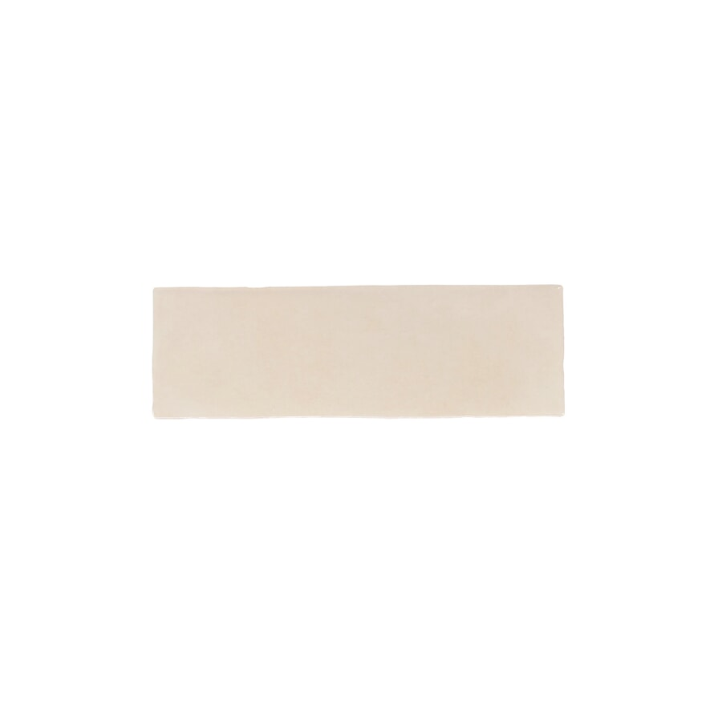
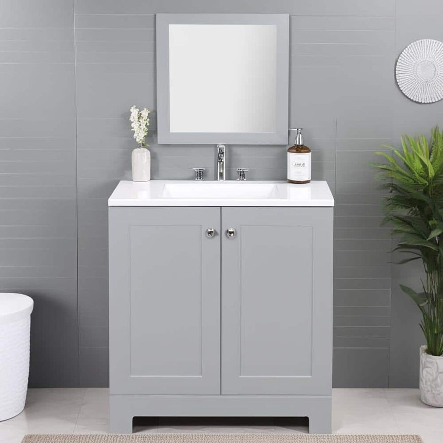

# Selections: Hall bath

Every product, finish and idea for this room: what's chosen, what's still open, what was
considered and passed on, and suggestions not yet decided. Updated whenever a link is
shared, an option is rendered, or something is picked.

Status: **idea** (suggested, nobody's looked yet) · **considering** (options on the table) ·
**chosen** · **ordered** · **installed** · **existing** (already there, staying).
Prices as seen on 2026-10-29.

## Open decisions

- Faucet: any 4" centerset in satin nickel, to match the vanity's knobs.

---

## Wall tile

**Status:** chosen (2026-10-29)

- **Bedrosians Cloe 2.5" x 8" glossy ceramic, Green.** About $8.29/sq ft (DesignShop), 10.64
  sq ft and 76 pieces per carton. Hand-made look, with uneven edges and shade variation.
  Running bond to 54" on the room walls and to 84" around the tub.
  - Link: https://allseasonamericanflooring.com/products/bedrosians-cloe-2-5-x-8-ceramic-wall-tile
  - Amount: about 100 sq ft with waste, so 10 cartons (about $880).
  - Saved: `intake/products/bedrosians-cloe-green-2.5x8.jpg`
  - Rendered: `renders/options/tile/` (`compare.jpg`)

**Considered:**
- Cloe Baby Blue: pretty, but pale enough that the room read as all white in the renders.
- Cloe Pink: a fun nod to 1950s baths, and too sweet next to the gray vanity.
- Cloe Creme (`bedrosians-cloe-creme-2.5x8.jpg`): too close to the walls to bother rendering.

**Notes:** green picked to keep the room's original color, in a deeper, glossier tile.

## Floor

**Status:** chosen

- **Merola Tile Classico Carrara Hexagon 7" x 8" porcelain, FEQCRX.** About $11.18/sq ft (Home
  Depot), 7.5 sq ft per case.
  - Link: https://www.homedepot.com/p/Merola-Tile-Classico-Carrara-Hexagon-7-in-x-8-in-Porcelain-Floor-and-Wall-Tile-7-5-sq-ft-Case-FEQCRX/300637966
  - Amount: 31.5 sq ft plus waste, so 5 cases (about $420).
  - Texture: `textures/carrara_hex.jpg` (generated: 7x8 hexes with Carrara veining, one 84"
    repeat).

## Vanity

**Status:** chosen

- **Glacier Bay Highgate 30" vanity, Pearl Gray, GB30P2-PG.** $241.29 on sale ($289.55), GoSource.
  - Link: https://shop.gosource.us/products/highgate_p_gb30p2-pg
  - Specs: 30.25" W x 18.75" D x 32.89" H, white cultured-marble top with an integrated sink,
    two shaker doors, satin nickel knobs, 4" centerset faucet holes.
  - Saved: `intake/products/glacier-bay-highgate-30-pearl-gray.jpg`, `-dims.jpg`
  - Fit: the sink bay is 31-1/2" (FROM PHOTO).

## Mirror

**Status:** chosen

- **Gatco Designer 5079LG frameless beveled oval mirror, 24" x 32".** About $123.
  - Link: https://build.com/gatco-5079lg/s1145297
  - Hung with its center at 58", over the vanity.

**Considered:**
- Keeping a medicine cabinet: the old one is surface-mounted; a recessed one needs the wall
  opened. The oval suits the curved tile better.

## Toilet

**Status:** chosen

- **Kohler Cimarron K-3851, two-piece round-front, 1.28 gpf, white.**
  - Link: https://build.com/kohler-k-3851-u/s561268
  - Spec sheet: https://techcomm.kohler.com/techcomm/pdf/K-3851_spec_US-CA_Kohler_en.pdf
  - Specs: 30-1/2" deep, 27-1/4" to the tank top, 16-1/2" rim, 10" rough-in.

**Considered:**
- Elongated bowls (Cimarron K-31648): 2" deeper, and the doorway side is already tight.

## Paint

**Status:** chosen

- **Warm white** above the tile (`warmwhite` in `lib/roomkit/materials.py`): any warm white
  eggshell. Lets the green carry the room.

## Tub

**Status:** existing

- The 60" x 30" alcove tub stays, with a new cream curtain.
